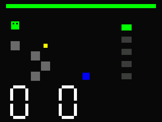

# Arcade AI Pet

[Scratch Arcade OS](https://github.com/ayutaz/scratch-arcade-os)向けに開発中の、
通信なしで使う相棒アプリです。日本語で話しかけると返事をして、
学習した行動を使う相棒と遊べる体験を目指します。

[English](README.md)

## 現在できること

小型の[日本語操作モデル](models/kws-v2/model-card.md)が、新しい合成音声の評価で
macro F1 **0.979**に達しました。重みは17,380Bです。
Cの特徴抽出と整数推論も、956例すべてでPythonと同じ判定になりました。

ペットは**5,142BのWASM package**になり、学習した移動・5操作の模擬認識結果・終了を両VMで確認しました。



*実WASMのホスト再生です。認識結果は模擬イベントで、実機の録画ではありません。*

入力補正版をESP32-S3へ適用しました。Wi-Fiを使わず、5操作・返答の再生・移動・録音消去を自動確認し、16appを保持しています。

**音声操作は未完成です。** 補正版でも合成5語は反応なしで、環境音3回のうち2回は「待つ」状態になりました。近づけた配置でも0/5、実声1語も反応なしでした。
[実機結果](docs/device-validation.md)に失敗と入力レベルの確認を記録しています。正式な実声精度・聴取・実LCD/物理入力は未確認です。

[ペットのbuildと試遊](docs/pet-app.md)。

[学習した移動policy](models/behavior-v1/model-card.md)は472B。未学習64盤面で平均8.64点、
ランダムは0.97点でした。整数Cも全7,680stepで同じ行動です。実機の性能ではありません。

## テスト

[uv](https://docs.astral.sh/uv/)を使用します。Pythonは3.12.13へ固定しています。

```sh
uv sync --locked
uv run --locked python -m unittest discover -s tests -v
uv run --locked --group train python -m unittest discover -s tests/training -v
```

最初の試験にはClangが必要ですが、音声エンジン・GPU・ネットワーク鍵・実機は不要です。
学習試験は小さなCPU用fixtureを使い、音声や製品モデルのダウンロードはしません。

## 学習の再現

MacではHomebrewでOpen JTalkを用意します。生成音声とモデルはGit対象外へ保存します。

```sh
brew install open-jtalk
uv run --locked --group train python -m arcade_ai_pet.data \
  --jtalk-root /opt/homebrew/opt/open-jtalk --output datasets/my-speech
uv run --locked --group train python -m arcade_ai_pet.training \
  --dataset datasets/my-speech --output checkpoints/my-model
```

260要素の発話位置を補正したMFCC/energyと、小型MLPを使います。
加工前の発話IDでデータを分割し、checkpointと拒否閾値はvalidationだけで選択します。
現在の合成データは同じ声を各splitで使用しており、未知の人の精度を測った結果ではありません。

MacのCPUで動き、Vast.aiのAPI呼出しはありません。クラウド学習は未接続です。
入力は16kHz/mono/PCM16の2秒です。
[受入条件](docs/acceptance.md)・[固定モデルの再現](docs/reproduce-model.md)・
[実験記録](docs/validation.md)・[データの条件](docs/data-license.md)を参照してください。

コードは[Apache-2.0](LICENSE)。音声モデル・生成/派生素材には別途CC BY 3.0の帰属条件があります。
小型の学習済みKWS重みと照合用の派生特徴を含めます。上流TTSの重みや本体の録音は含めません。

実声評価の[固定手順と匿名の集計](docs/voice-validation.md)を用意しています。
