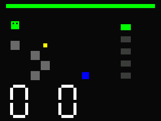

# Arcade AI Pet

An offline companion for [Scratch Arcade OS](https://github.com/ayutaz/scratch-arcade-os).
Move around with a pet that uses a learned policy, or try five short Japanese voice commands.
The app runs as a small WASM package; speech recognition runs in the OS.

[日本語](README.ja.md)



*Actual WASM host replay with simulated voice-result events. This is not a device recording.*

## Current status

**Experimental source edition. Human-voice acceptance remains incomplete.**
[Release notes](docs/release-notes/v0.1.0.md).

| Part | Evidence |
|---|---|
| Pet app 1.0.1 | 5,176-byte package; movement, voice-result actions and exit tested in both host VMs |
| Learned movement | 472-byte policy; 8.64 points vs 0.97 for seeded random play on 64 unseen host boards |
| [Fixed voice candidate](models/kws-logmel-v1/model-card.md) | 23,411 bytes of numeric parameters; all 3,448 C/Python decisions match; eight reserved synthetic profiles pass |
| Latest handheld check (3522 firmware) | 4/5 commands, 0/5 negative activations, no internal errors; four accepted replies complete; 16 apps preserved |
| Known limits | Pet can fail to launch after Wi-Fi use; a normal restart recovers it. A smaller workspace fix is built but not installed. The new model has no human-voice result yet |

The previous model scored **6/15 human commands**, below the 12/15 target.
The new synthetic results do not replace that human trial or prove reliable voice control.
See the [current device checks](docs/logmel-device-check.md) and
[earlier voice trials](docs/voice-validation.md).

## Try it on your computer

Use [uv](https://docs.astral.sh/uv/) and the pinned Python 3.12.13. Tests need Clang.
No device, GPU, API key or speech-engine download is required for these checks.

```sh
uv sync --locked
uv run --locked python -m unittest discover -s tests -v
```

[Build and play in the Mac simulator](docs/pet-app.md).
The simulator uses buttons and simulated voice results; it does not record your microphone.
Handheld installation requires a separately reviewed OS update, not just an SDK update.

## Models and reproduction

The pet recognizes **あそぼ / おいで / まって / おやすみ / ありがとう**,
plus unknown speech and silence. It is a five-command classifier, not general Japanese ASR or a conversational model.

- [Fixed log-mel model, evaluation and host example](models/kws-logmel-v1/model-card.md)
- [Learned movement model](models/behavior-v1/model-card.md)
- [Synthetic-data auditing](docs/generated-audio-audit.md) and [data licenses](docs/data-license.md)
- [Earlier CPU training recipe](docs/reproduce-model.md) and [experiment history](docs/validation.md)

Code is [Apache-2.0](LICENSE). Voice weights and derived numeric assets have
[separate attribution and license terms](models/kws-logmel-v1/LICENSE.txt).
Upstream TTS weights, generated audio and device recordings are not included.
[Source release procedure](docs/releases.md).
